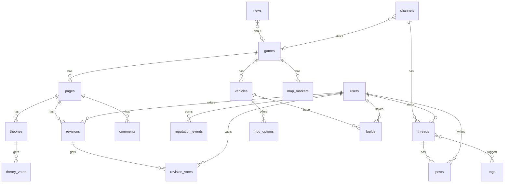

# GTA Wiki: technical architecture

Implements the product and design decisions in [`design/DESIGN.md`](../design/DESIGN.md) and `design/gta-wiki-hub.figcraft` (exported screens in `design/screens/`).

The GTA VI countdown that used to live in this repo is now part of the home page.

## Product rules the code must keep

1. One continuous wiki for the whole series. No game switcher, toggle or per-game mode. Context comes from the URL, breadcrumbs and neutral badges.
2. Verification (`official`, `leak`, `theory`) is data on articles, facts and news, always with a source.
3. An edit that adds content without an official source waits for 5 community reviewers. Reputation moves with the outcome.
4. Tools: multi-game vehicle comparator, build creator, forum with tags and spoiler blur, map with time-gated marker layers.
5. Accounts: Google, Apple, Discord, email and password.
6. Ads never touch article text or spoilers.

## Stack

| Layer | Choice | Why |
|---|---|---|
| Framework | Next.js 16 (App Router), React 19, TypeScript strict | SEO is the product: launch traffic arrives from search, so article pages must be server-rendered and cacheable. One codebase for UI and server logic |
| Styling | Tailwind CSS 4 with tokens from `DESIGN.md` as CSS variables | Tokens stay in one file; no component library, because the design is custom |
| Server state | React Server Components and Server Actions | Most pages are reads. No client data cache is needed for the first version |
| Client state | Local `useState` and URL search params | Filters, compare slots and map layers belong in the URL so they can be shared. No store library |
| Database | PostgreSQL 16 | Relational data, plus full-text search and `pg_trgm` without another service |
| ORM | Drizzle with `postgres` driver | Typed SQL, plain migration files, no runtime engine |
| Auth | Better Auth | Email and password plus Google, Apple and Discord, stored in our Postgres |
| Validation | Zod | One schema per Server Action input |
| Search | Postgres `tsvector` + `pg_trgm` | Good enough for the corpus and one less service. The search module has one entry point, so it can move to Meilisearch later |
| Cache | Next.js data cache with tag revalidation; CDN in front | Redis is left out on purpose: nothing needs it yet. See "Scaling" |
| Images | `next/image` with `sharp`, served through the CDN | Media is the heaviest thing on the page |
| Tests | Vitest (unit and integration against real Postgres), Playwright (flows, both viewports) | Business rules are tested against the real database, not mocks |
| CI | GitHub Actions: lint, typecheck, tests, build | Runs on every push to `main` |
| Hosting | Docker image on a VPS (Coolify) behind Cloudflare, or Vercel + Neon | The app is a standard Node server; see "Deployment" |

Reference scale: launch-week spike of read traffic, low write volume. Reads must survive on cached HTML; writes go to one Postgres.

## Languages and themes

English has no URL prefix; Portuguese lives under `/pt`, so both languages stay cacheable and indexable. `src/proxy.ts` (next-intl) picks the language from the saved cookie, then from `Accept-Language`. The header switch writes the cookie.

- Interface text: the English sentence is the key. `t('...')` looks it up in `src/i18n/pt.ts` and falls back to English. `tests/unit/i18n.test.ts` fails when a key is missing or its placeholders differ. Word order changes by language, so write whole sentences with `{placeholders}`, never joined fragments.
- Facts in the database: a row carries `i18n.pt`, and `localize(row, locale)` overlays it. Game hubs, page titles, summaries, infoboxes, news and channels work this way.
- Article text: each language has its own revisions. `revisions.locale` says which, and `pages.current_revision_pt` points at the Portuguese text. An untranslated page shows English with a note. Review works the same in both languages.
- Community content (threads, comments, theories) stays in the language it was written in.
- Cached pages must call `pageLocale(params)` before anything reads the locale, or they turn dynamic.

Themes: dark is the base, and `[data-theme='light']` in `src/styles/tokens.css` swaps the same token names. A small inline script sets the theme before first paint, from the saved choice or `prefers-color-scheme`. Colours in components must be tokens.

## Rendering and caching

| Route type | Strategy |
|---|---|
| Home, `/games`, game hubs, articles, stories, threads | Server-rendered and cached, revalidated by path when content changes, 30 to 300 s time-based fallback |
| News and forum lists | Dynamic, because filters live in the URL. Put a short CDN cache in front for launch |
| Search, history, profile, compare, builder | Dynamic per request |
| Viewer-specific bits (vote state, account menu) | Read per request in dynamic pages. On cached pages they load in small client islands so the page stays cacheable |
| Countdown | Client island counting to a single instant, `2026-11-19T00:00:00Z`, server-rendered with the current value |

## Routes

```
/                                      home, franchise hub
/games                                 all games
/[game]                                game hub (/gta-6, /gta-5, /gta-san-andreas)
/[game]/[section]/[slug]               article (/gta-6/characters/lucia)
/[game]/[section]/[slug]/edit          editor
/[game]/[section]/[slug]/history       revisions, diff, review
/[game]/map                            interactive map
/search?q=                             results; /api/search/suggest for autocomplete
/database/vehicles/compare?v=a,b,c     comparator, state in the URL
/database/builds/new                   build creator
/b/[code]                              shared build
/news                                  news and rumors
/videos?game=&kind=                    official Rockstar videos, player loads on click
/about, /policies, /privacy, /terms     site pages
/forums, /forums/[channel]             forum
/forums/[channel]/[thread]             thread
/u/[username]                          profile
/signin, /signup, /onboarding          account
```

## Data model



| Table | Key columns |
|---|---|
| `games` | `slug`, `name`, `short_name`, `year`, `universe` (`hd`, `3d`, `2d`), `setting`, `leads`, `release_at`, `sort_order`, `hub` (json facts) |
| `pages` | `game_id`, `section` (`characters`, `vehicles`, `weapons`, `missions`, `locations`, `guides`, `lore`), `slug`, `title`, `summary`, `status`, `source`, `image`, `infobox` (json), `current_revision_id`, `search` (tsvector). Unique on game, section, slug |
| `revisions` | `page_id`, `author_id`, `parent_id`, `body` (markdown), `summary`, `source_kind` (`official`, `community`, `none`), `source`, `state` (`pending`, `accepted`, `reverted`), `size_delta` |
| `revision_votes` | `revision_id`, `user_id`, `vote` (`keep`, `revert`). Primary key on both ids |
| `theories`, `theory_votes` | Per-page theories; votes are `up`/`down` plus a `plausible` flag used for the consensus bar |
| `comments` | `page_id`, `parent_id`, `author_id`, `body`, `score` |
| `reputation_events` | `user_id`, `kind`, `amount`, `ref`. A user's rep is the sum; `profiles.rep` caches it |
| `profiles` | `user_id`, `username`, `avatar` (character key), `favorite_game_id`, `rep`, `role` (`member`, `reviewer`, `moderator`), `onboarded_at` |
| `channels`, `threads`, `posts`, `tags`, `thread_tags`, `post_votes`, `thread_votes` | Forum. `threads.spoiler`, `posts.spoiler`, `threads.pinned`, cached `score` and `reply_count` |
| `news` | `game_id`, `slug`, `title`, `excerpt`, `body`, `status`, `source`, `image`, `published_at`, `sponsored` |
| `vehicles` | `game_id`, `slug`, `name`, `class`, `seats`, `specs` (json, nullable numbers), `specs_verified`, `image`, `price` |
| `mod_categories`, `mod_options`, `builds` | Options per vehicle or class with price and stat deltas; `builds.code` is the short share id, `builds.choices` is json |
| `map_markers` | `game_id`, `layer` (`trailer`, `leak`, `theory`, `mission`, `collectible`, `easter_egg`), `title`, `x`, `y`, `status`, `source`, `image`, `visible_from` |

Better Auth owns its own tables (`user`, `session`, `account`, `verification`). `profiles` extends `user` one to one.

## Edit review

1. An edit citing a link on an allowed official host (`src/lib/sources.ts`) is `accepted` at once. Choosing "official" with any other source is refused, so nobody can skip review.
2. Anything else is `pending`. The article keeps showing the current accepted revision.
3. Users with the `reviewer` role or rep at or above the reviewer threshold can vote. Authors cannot vote on their own edit.
4. After 5 votes, the majority wins. Accepted: the revision becomes current and, if community-sourced, the article shows an unverified leak marker with that source. Reverted: the revision closes.
   If the article changed during the review, an accepted edit closes unpaid instead of erasing the newer text.
5. Reputation: +10 for an accepted edit, -15 for a reverted one. Applied once, in the same transaction that closes the review, enforced by a unique key on `reputation_events (kind, ref)`.

## Project layout

```
src/
  app/                 routes only: pages, layouts, route handlers
  components/ui/       design system parts (Status, Tag, Votes, Breadcrumbs, AdSlot)
  components/layout/   Header, Footer, MobileMenu, BottomNav
  components/<area>/   feature components (article, forum, map, compare)
  server/db/           Drizzle schema, client, migrations, seed
  server/<area>/       queries.ts and actions.ts per domain; all business rules live here
  lib/                 pure helpers
  styles/tokens.css    the design tokens
tests/
  integration/         rules against real Postgres
  e2e/                 Playwright flows
docs/                  architecture and deployment
design/                source of truth for screens
```

**Conventions.** Business rules live in `src/server`, never in components. Server Actions validate with Zod and check the session first. Components are server components unless they need the browser. Colours, radii and spacing come from tokens, never hard-coded. Commits are small and reference their issue.

## Testing

- `npm run lint`, `npm run typecheck`, `npm test` and `npm run build` must pass before an issue closes.
- Integration tests cover the review flow, reputation, voting and permissions on real Postgres.
- Playwright runs the main flows at 1440 and 390 against `gtawiki_e2e`, a database rebuilt on every run by `tests/e2e-db.ts`, so tests never touch development data.

## Deployment

The app needs a Node server and Postgres, so it cannot run on GitHub Pages. The old Pages workflow is gone, which leaves the last countdown deploy live until DNS or the Pages setting changes. `docs/DEPLOYMENT.md` covers production setup.

Secrets needed in production: `DATABASE_URL`, `BETTER_AUTH_SECRET`, `BETTER_AUTH_URL`, and the client id and secret for each OAuth provider. A provider without credentials hides its button.

## Scaling

Add these when measurements call for them, in this order: a read replica for Postgres, Redis for rate limits and hot counters, Meilisearch for search.
